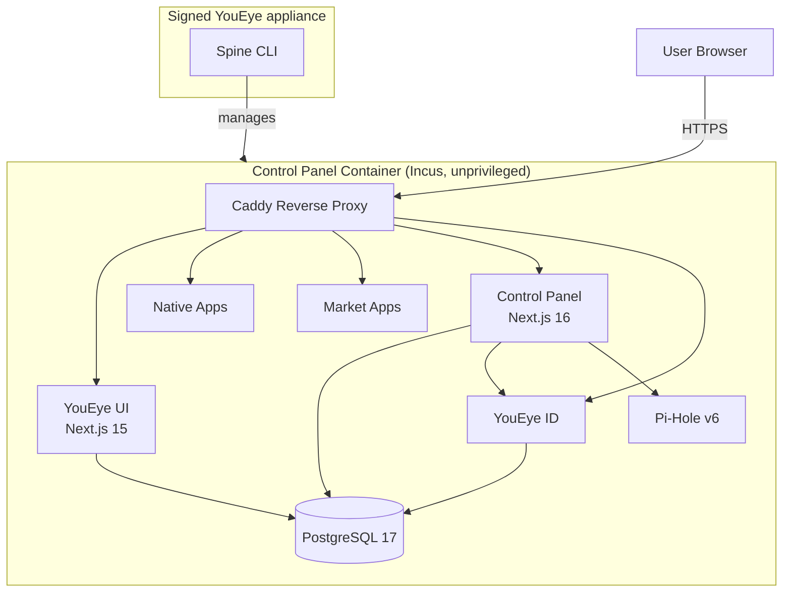
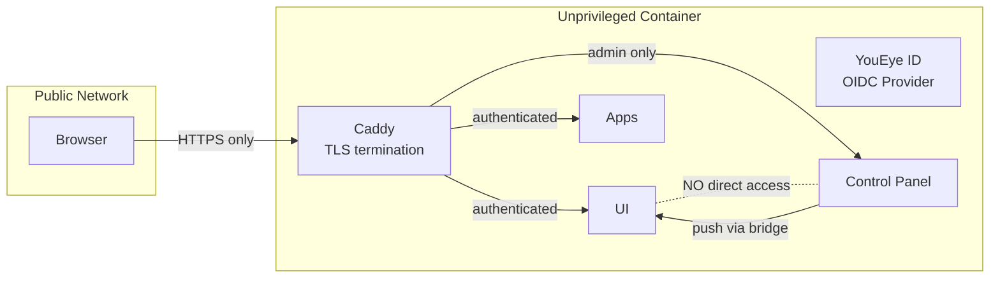
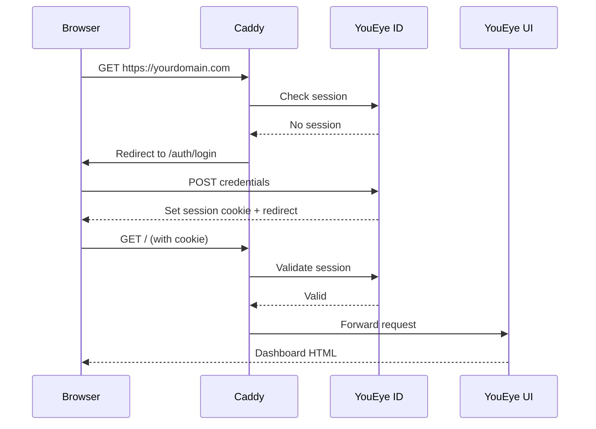
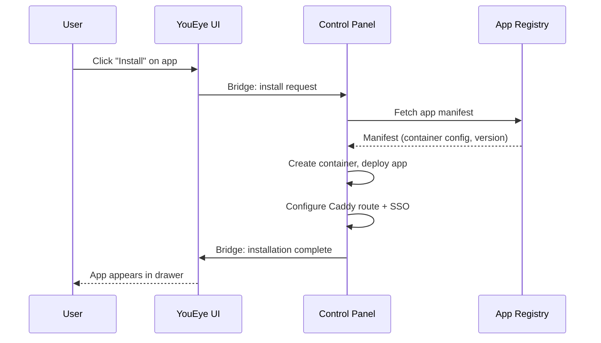
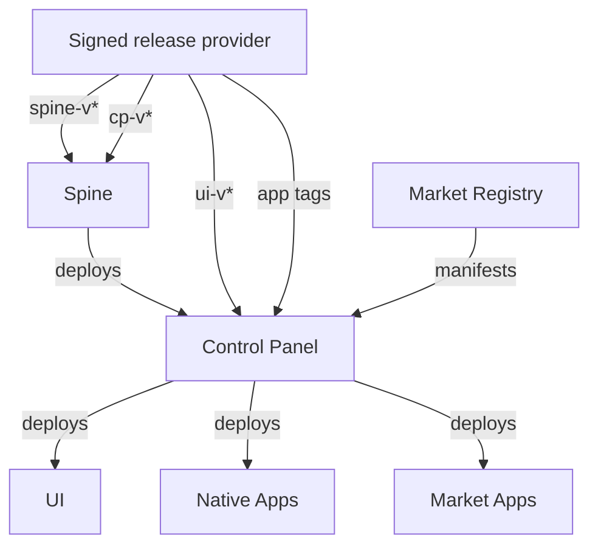

# Architecture

YouEye uses a layered architecture where each component has a single responsibility and clear boundaries.

## System Overview



## Component Boundaries

Control Panel network reconciliation performs one global inventory audit per
pass, then checks unchanged apps using a pass-local read-only observation. The
audit transport rejects every attempted mutation before it reaches Incus, so
unchanged comparisons need no mutation locks. Only wholly unchanged passes lend
their inventory summary to the outer scan; repair or ownership/admission races
require a new outer observation. Any
drift or unknown result falls back to fresh full ownership observation inside
the existing app lifecycle and network locks; repairs never use cached objects.
Durable lease identity is reread after admission, shared observations are discarded
before a repair, and no observation survives a pass. UI registration reads are
batched per pass together with persisted connection projections; unchanged
projections and health records produce no writes. With a wholly unchanged network
audit, existing registrations and completed install receipts use a mutation-blocked
projection comparison before taking lifecycle locks or rereading individual bridges.
Any divergence, missing registration, or unfinished operation still enters fresh
under-lock visibility and repair checks. Absent registrations are
rechecked before creation and verified afterward. UI visibility checks read the exact current active lease and owned
bridge rather than enumerating unrelated networks.
Owned ACL, proxy and NIC configuration is compared before writing, so unchanged
state needs no provider mutation. Incus JSON requests share bounded keep-alive
connections per process, preserve inactivity/explicit deadline handling, and
never automatically replay a failed mutation with an uncertain outcome. A bodyless
GET reset on a reused socket before any response retries at most once through
the same bounded pool and admission slot; its original absolute deadline stays
in force. Fresh-connection failures and partial responses remain errors.

### Spine (Host)

Spine is a Go binary that runs on the host system. Its responsibilities are strictly limited:

- Install and manage Incus
- Create the unprivileged container
- Deploy the Control Panel into the container
- Update itself and the Control Panel
- Report platform status

On sealed appliances, the storage boot phase validates persisted Incus DNS
process records before the Incus sockets or daemon start. Records for missing
processes or reused PIDs are discarded without signalling processes; genuine
live helpers are retained for same-boot daemon restarts. Network configuration
and DHCP leases remain persistent.

**Spine does NOT manage** the UI, native apps, Market-installed apps, or any infrastructure inside the container. That's the Control Panel's job.

### Control Panel (Container)

The Control Panel is the orchestration engine. It manages everything inside the container:

- PostgreSQL database
- YouEye ID (SSO/OIDC)
- Caddy (reverse proxy, TLS)
- Pi-Hole (DNS)
- YouEye UI deployment
- Reapply the protected persistent UI database and SSO configuration after UI
  container recreation, preserving the existing OAuth client and session secret.
  A configured UI is ready only after its database schema is available; an
  unconfigured UI can boot for the initial setup wizard.
- Native app deployment
- Market app lifecycle

### UI (Container)

The UI is the user-facing dashboard. It provides:

- Widget management (drag, drop, resize)
- Theme and appearance engine
- User settings
- App drawer and notifications
- Bridge API endpoints for CP communication

### Native Apps (Container)

Each native app runs as its own process with:

- Its own subdomain route via Caddy
- SSO integration via YouEye ID
- Access to the shared PostgreSQL database
- Theme and language synchronization with the UI

## Security Model



Key security principles:

| Principle | Implementation |
|-----------|---------------|
| **Unprivileged container** | The entire stack runs in an unprivileged Incus container — no root on the host |
| **Single entry point** | All traffic enters through Caddy (port 443 only) |
| **Automatic TLS** | Caddy provisions and renews certificates automatically |
| **SSO everywhere** | YouEye ID gates apps and services - no separate logins |
| **One-way bridge** | CP pushes data to UI via bridge API; UI cannot call CP |
| **Network isolation** | UI container is firewalled from reaching CP directly |

## Data Flow

### User Authentication



### App Installation



## Tech Stack

| Component | Technology | Purpose |
|-----------|-----------|---------|
| **Spine** | Go 1.21+, Cobra, Bubble Tea | Host lifecycle and signed-release manager |
| **Installer** | Go, Bubble Tea | Signed ISO and Proxmox installation flows |
| **Control Panel** | Next.js 16, TypeScript | Infrastructure orchestration |
| **UI** | Next.js 15, Drizzle ORM, Radix UI, DND-Kit, Framer Motion | User dashboard |
| **Native Apps** | Next.js 15 | Wiki, Search, Notes, Cinema, Weather, Translate |
| **Database** | PostgreSQL 17 | Shared data store |
| **SSO** | YouEye ID | OIDC identity provider |
| **Proxy** | Caddy | Reverse proxy with automatic HTTPS |
| **DNS** | Pi-Hole v6 | DNS filtering and local resolution |
| **Containers** | Incus (LXD fork) | Lightweight system containers |

## Monorepo Structure

```
YouEye/
├── installer/          # YouEye Installer binary and Proxmox bootstrap
├── appliance/          # Signed A/B/Recovery image lifecycle
├── spine/              # Go CLI (Spine)
│   ├── cmd/            # CLI entry point
│   └── internal/       # Commands, config, release and lifecycle services
├── control-panel/      # Next.js 16 (Control Panel)
│   ├── src/            # Application source
│   ├── prisma/         # Database schema (unused, legacy)
│   └── package.json
├── ui/                 # Next.js 15 (Dashboard UI)
│   ├── src/            # Application source
│   ├── drizzle/        # Database migrations
│   └── package.json
└── docs/               # This documentation
```

Each component is **versioned independently** and released with its own tag prefix (`spine-v*`, `cp-v*`, `ui-v*`).

## Update System

Spine manages updates for itself and the Control Panel. The Control Panel manages updates for everything else.



Updates default to official GitHub Stable releases. An administrator may select
an explicit Forgejo or custom HTTPS source without changing distributed build
defaults. Each mutation requires signed checksum metadata, the exact artifact
digest, and any configured channel digest. Missing releases do not fall back
across channels.

UI infrastructure reconciliation also restores the existing protected bridge authority after container recreation, and verifies its bytes and file mode before readiness. This applies when an interrupted update did not reach Spine finalization. Reconciliation never issues a replacement bridge identity; missing authority on a configured appliance remains a failed repair.

### Bounded background observations

Control Panel and YouEye ID each reuse one PostgreSQL connection per server
process for platform identity/admission and durable health-registry SQL. Health
observations keep their existing persistence and polling semantics while reusing
this transport instead of starting a container command for each read/write.
The pool is shared across route
bundles, admits at most 64 waiting commands with a 15-second deadline, and retains
the existing SQL quoting, text results and transaction boundaries. Credentials
come from the protected Spine socket and remain in server memory. SQL failures
roll back; disconnected connections are discarded and credentials refreshed on
the next request. A failed write is never automatically replayed because its
commit outcome may be unknown. These two connections must be included alongside
UI and native-app allocations in the PostgreSQL connection budget.

Dashboard health requests and the background monitor share a 15-second snapshot
and one in-flight collection per process. Incus file reads obtain uptime and
version metadata without creating guest exec operations. Spine's existing
30-second status cache also coalesces concurrent misses. These display caches do
not change admission, revocation, update ownership or watchdog deadlines.

Host metrics also share a 15-second observation in Spine. CPU uses aggregate
kernel-counter deltas between observations, excluding duplicate guest counters
and counting I/O wait as idle. A cold reader uses a bounded 200ms initial sample;
subsequent dashboard observations cover the sampling interval. The System cards
refresh 15 seconds after each completed request without a full-page loading
transition, so the initial page-load CPU spike does not remain frozen on screen.
No host-metrics timer runs when there are no readers.

System service restarts obtain the current session CSRF token and require an
explicit success receipt. Rejected restart requests remain visible in the service
panel; a still-running service does not establish that a restart occurred.

The appliance's physical and serial consoles retain their two-second snapshot
cadence but cap Bubble Tea rendering at five frames per second. Returning from a
console command reuses the existing tick instead of starting an additional loop.
